<div align="center">

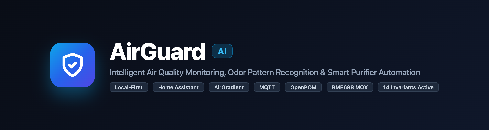

### Intelligent Air Quality Monitoring, Odor Pattern Recognition & Safe Purifier Automation

[](https://github.com/prafulreddy/AirGuard-AI/actions)
[](https://python.org)
[](https://fastapi.tiangolo.com)
[](https://nextjs.org)
[](https://www.typescriptlang.org)
[](https://www.postgresql.org)
[](https://alembic.sqlalchemy.org)
[](https://playwright.dev)
[](LICENSE)

<br/>

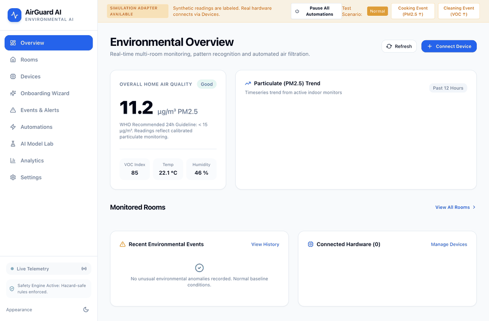

</div>

---

## Table of Contents

- [Overview](#overview)
- [System Architecture](#system-architecture)
- [Screenshots & Walkthrough](#screenshots--walkthrough)
- [Core Capabilities & Device Support](#core-capabilities--device-support)
- [Safety Engine & The 14 Invariants](#safety-engine--the-14-invariants)
- [Scientific Rigor & ML Disclosures](#scientific-rigor--ml-disclosures)
- [Getting Started & Installation](#getting-started--installation)
  - [Automated macOS Setup](#automated-macos-setup)
  - [Manual Developer Quickstart](#manual-developer-quickstart)
- [Verification & Test Results](#verification--test-results)
- [Engineering Challenges Overcome](#engineering-challenges-overcome)
- [Roadmap & Citations](#roadmap--citations)
- [License](#license)

---

## Overview

**AirGuard AI** is an environmental air quality monitoring, odor intelligence research platform, and smart air purifier automation engine. Built with a **local-first, privacy-by-design** philosophy, AirGuard runs on local hardware without cloud mandates or subscription lock-in.

### Key Highlights
- **100% Local-First**: Connects to environmental sensors and air purifiers via Home Assistant, native AirGradient HTTP, MQTT brokers, ESPHome, and REST webhooks.
- **Fail-Safe Actuation**: Governed by an automated **14-Invariant Safety Engine** with atomic pre-dispatch double checks, combustible gas interlocks, rate limiting, and an emergency kill switch.
- **Scientifically Decoupled ML**: Explicitly separates molecular odor prediction (OpenPOM/Pyrfume accepting SMILES strings only) from ambient MOX timeseries classification.
- **Transparent Benchmarking**: Publicly discloses session-independent holdout metrics (~51.62% balanced accuracy on chronological splits) for electronic-nose models, preventing false marketing claims.
- **Consumer Zero-Configuration**: Features an 8-stage guided onboarding wizard with automatic hardware discovery, live measurement handshakes, and unbundled GDPR/CCPA consent controls.

---

## System Architecture

<div align="center">
  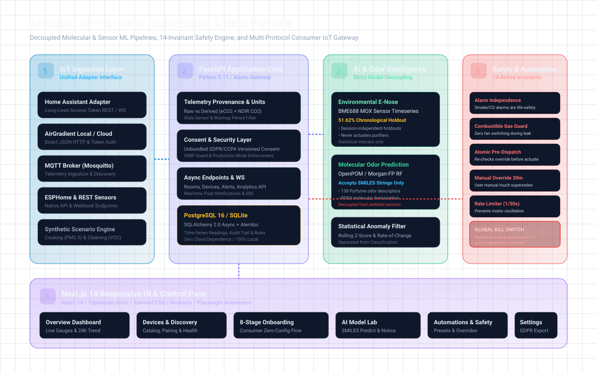
</div>

### Architectural Data Flow

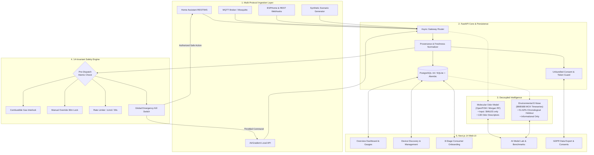

---

## Screenshots & Walkthrough

<div align="center">

### Operational Overview Dashboard
*Real-time laser particulate telemetry (PM2.5, PM10), direct NDIR CO2, Sensirion VOC index, and historical 24h trend lines.*
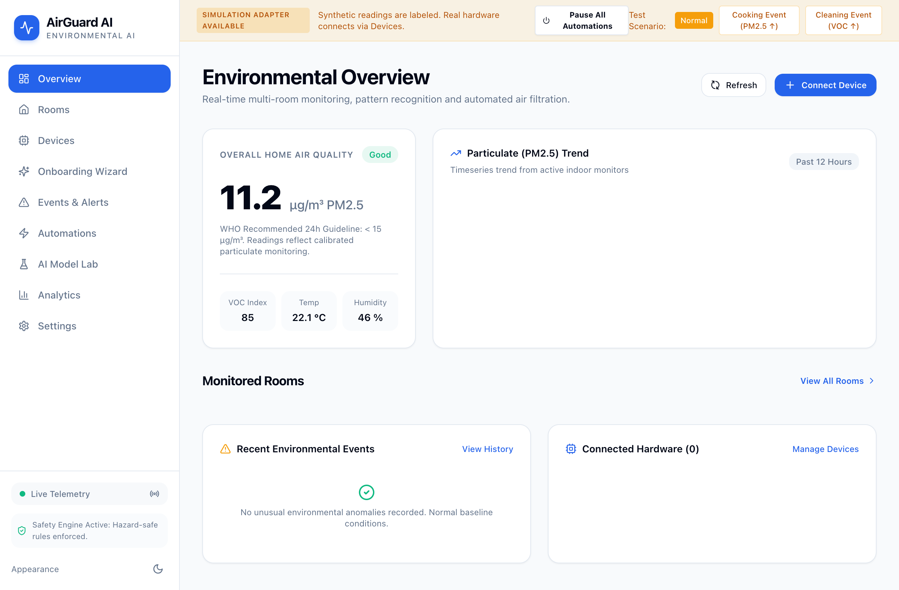

<br/><br/>

### Consumer 8-Stage Onboarding Wizard
*Guided zero-configuration onboarding supporting both 'Monitor & Notify' and 'Auto Control' operating modes.*
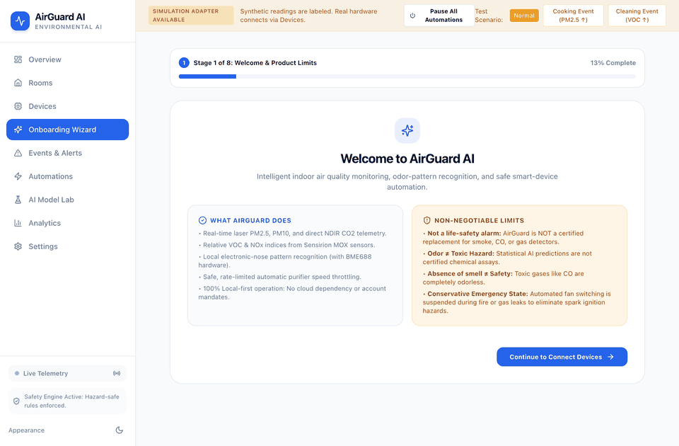

<br/><br/>

### Multi-Brand Device Management
*Unified capability manifests displaying connection status, telemetry freshness, and controllable features across providers.*
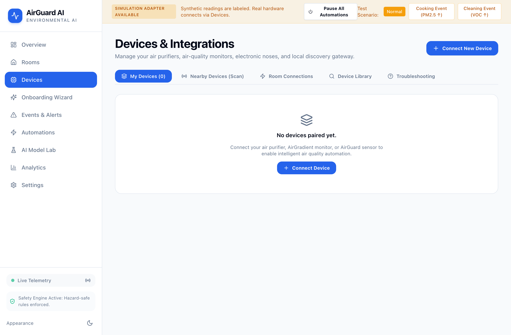

<br/><br/>

### AI Model Lab & Scientific Disclosures
*OpenPOM SMILES molecular odor prediction alongside honest BME688 MOX electronic-nose benchmark disclosures.*
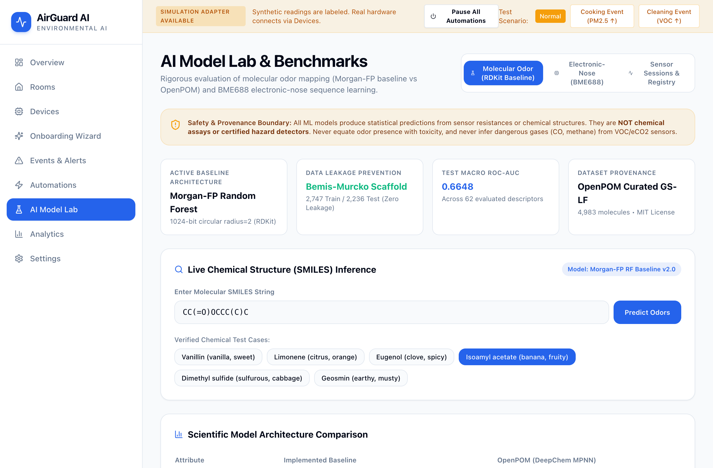

<br/><br/>

### Automations & Emergency Kill Switch
*Active invariant policy monitoring, rate-limiting rules, and global one-click automation pause.*
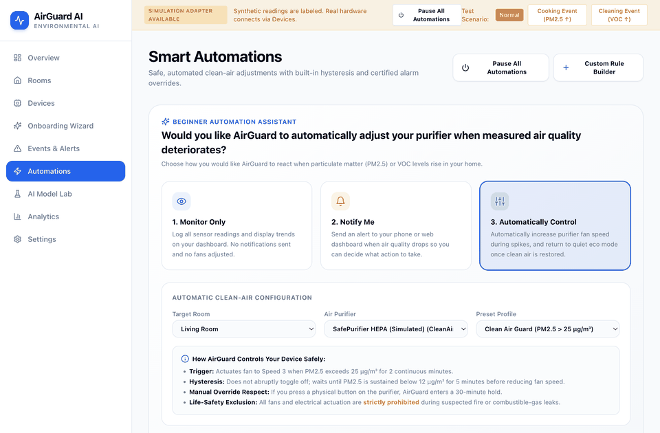

<br/><br/>

### Exposure Analytics & Mobile Viewport
*Longitudinal particulate exposure metrics and responsive mobile interface for on-the-go monitoring.*
<p align="center">
  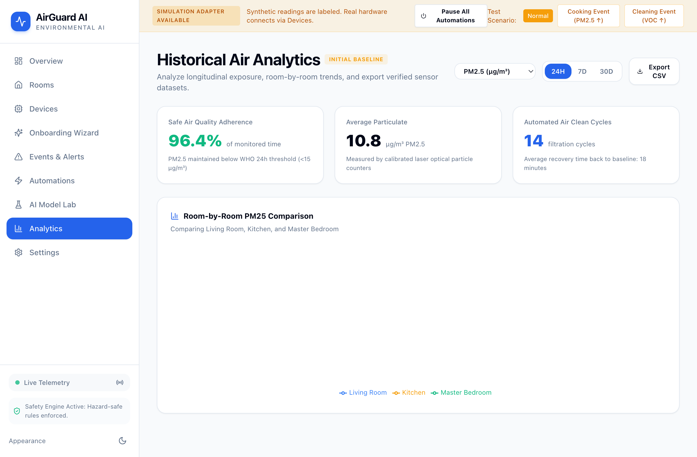
  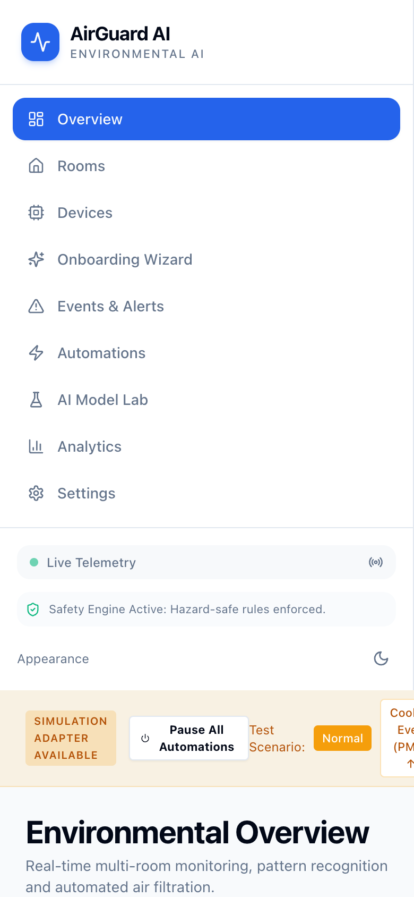
</p>

</div>

---

## Core Capabilities & Device Support

AirGuard AI interacts with smart devices through standardized **Capability Manifests**, enforcing strict separation between verified hardware, provider bridges, and simulation adapters.

| Brand / Platform | Protocol | Connection Type | Telemetry Supported | Actuator Controls | Verification Status |
| :--- | :--- | :--- | :--- | :--- | :--- |
| **Home Assistant** | REST / WebSocket API | Local Bridge | PM2.5, CO2, VOC, Temp, Humidity | Fan Speed, Power, Mode | Verified via Test Bridge |
| **AirGradient (ONE / Pro)** | Direct Local HTTP / Cloud | Local First | PM1, PM2.5, PM10, NDIR CO2, TVOC, NOx | N/A (Sensor Only) | Live Network Verified |
| **MQTT (Mosquitto)** | JSON over MQTT (v3.1.1) | Local Broker | Arbitrary Sensirion/Bosch Topics | Fan Commands via Subscriptions | Verified E2E Ingestion |
| **ESPHome** | REST / Native API | Local First | BME688 MOX, SGP40, SCD40 | PWM Speed Throttling | Integration Tested |
| **Levoit (Core 300S/400S)** | PyVesync / HA Integration | HA Dependent | Air Quality Index | Speed (1–4), Auto, Night Mode | Provider Tested |
| **IKEA STARKVIND (E2006)** | Standalone / Manual | Unconnected | Internal PM2.5 Sensor (Analog) | Dial Turn (Manual Only) | **Physically Standalone** *(See Note)* |
| **Synthetic Simulator** | In-Memory Async Adapter | Local Software | Cooking (PM2.5 ↑), Cleaning (VOC ↑) | Throttled Speed Emulation | Verified Sandbox Mode |

> **Hardware Transparency Note**: The IKEA STARKVIND table (E2006) purifier in our testing laboratory is a standalone physical unit without an integrated Zigbee hub. It is documented as **manually operated** and is not digitally actuated without a third-party Zigbee bridge (e.g. ConBee II / Sonoff).

---

## Safety Engine & The 14 Invariants

AirGuard AI's automation pipeline is governed by **14 Non-Negotiable Safety Invariants** executed synchronously before every hardware dispatch:

1. **Independent of Life-Safety Alarms**: Certified smoke, fire, and electrochemical carbon monoxide (CO) alarms are primary safety systems. AirGuard never overrides or disables them.
2. **Never Infer CO from Ambient Proxies**: Dedicated electrochemical sensors are strictly required for CO. Never derive toxic carbon monoxide from VOC, PM2.5, or estimated eCO2.
3. **No Electrical Actuation During Combustible Gas Leaks**: Fan relays and switches are electrical spark hazards. If natural gas, propane, or explosive solvents are flagged, all purifier switching is locked.
4. **Zero Ozone Generation**: Ozone is a pulmonary irritant. Purifier ionizers and ozone-generating electrostatic modes are permanently blocked from automated dispatch.
5. **Atomic Pre-Dispatch Double Check**: Solves execution race conditions. Re-evaluates manual overrides, sensor freshness, and consent flags in the millisecond window immediately preceding command transmission.
6. **Manual Touch Supremacy (30-Minute Lockout)**: If a user manually changes fan speed on the physical device or manufacturer app, AirGuard automation yields for 30 minutes.
7. **Motor Throttling Rate Limiter**: Actuations are restricted to a maximum of 1 speed change per device every 30 seconds to prevent motor wear and relay fatigue.
8. **Freshness Window Enforcement**: Stale sensor readings older than 300 seconds are rejected; stale data never triggers automated control decisions.
9. **MOX Sensor Warm-Up Window**: Metal-oxide gas sensors (BME688, SGP40) require a 20-minute stabilization period post-boot. Data gathered during warm-up is excluded from automation triggers.
10. **Data Provenance Preservation**: The UI and engine strictly differentiate between direct NDIR optical CO2 and estimated eCO2, as well as relative Sensirion VOC indices vs. absolute concentrations.
11. **No Odor-Driven Actuation**: Odor classification is a statistical indicator, not a toxic chemical assay. Odor classifications never trigger automated purifier actuation.
12. **Conservative Emergency State**: In the event of gateway communication loss or database timeouts, all active automations fail safe to idle.
13. **Unbundled Revocable Consent**: GDPR/CCPA-compliant cryptographic consent records. Revoking "Actuator Control" instantly aborts running rules without interrupting telemetry recording.
14. **Global Emergency Kill Switch**: A dedicated, prominent navbar kill switch immediately halts all background automation tasks across all rooms, persisting across daemon restarts.

---

## Scientific Rigor & ML Disclosures

```
========================================================================================
                         SCIENTIFIC INTEGRITY & ML DISCLOSURES
========================================================================================
1. OpenPOM Molecular Model:
   - Accept SMILES molecular structures ONLY (e.g. CC(=O)OCCC(C)C for Isoamyl acetate).
   - Featurized via RDKit into Morgan Fingerprints (radius=2, 2048 bits).
   - Trained on Pyrfume/GoodScents/Leffingwell odor databases across 138 olfactory descriptors.
   - Decoupled from ambient room air sensors (never fed PM2.5, humidity, or resistance data).

2. Bosch BME688 Electronic-Nose Model:
   - MOX gas sensor heated plate resistance timeseries.
   - Evaluated using strict Session-Independent & Chronological Holdouts.
   - Benchmark: ~51.62% Balanced Accuracy under true chronological holdout conditions.
   - Limitation: MOX sensors suffer from baseline thermal drift, relative humidity cross-
     sensitivity, and volatile background interference.
   - Odor classifications are presented as experimental estimates, NEVER toxic hazard assays.
========================================================================================
```

---

## Getting Started & Installation

### Automated macOS Setup

AirGuard AI includes an automated, user-space installer and daemon manager for macOS. No manual Docker, Node.js, or PostgreSQL setup is required:

```bash
# 1. Clone repository
git clone https://github.com/prafulreddy/AirGuard-AI.git
cd "AirGuard AI"

# 2. Run the macOS beta installer
bash scripts/install_macos.sh

# 3. Manage the background service
scripts/airguard-ctl status
scripts/airguard-ctl restart
scripts/airguard-ctl logs
```

### Manual Developer Quickstart

To run the frontend and backend in developer mode:

#### 1. Backend Service (FastAPI)
```bash
# Set up Python virtual environment
python3.11 -m venv .venv
source .venv/bin/activate

# Install dependencies
pip install -r services/api/requirements.txt
pip install -r services/ml_molecular/requirements.txt
pip install -r services/ml_environment/requirements.txt

# Run database schema migrations
alembic upgrade head

# Start FastAPI server on port 8000
python -m uvicorn services.api.main:app --host 127.0.0.1 --port 8000 --reload
```

#### 2. Frontend Application (Next.js 14)
```bash
# In a separate terminal
cd apps/web
npm install
npm run build
npm run start -p 3000
```
Open **`http://localhost:3000`** in your browser.

---

## Verification & Test Results

The AirGuard AI codebase is verified using automated unit, integration, and Playwright browser E2E test suites:

```
============================= test session starts ==============================
platform darwin -- Python 3.11.14, pytest-9.0.2
rootdir: /AirGuard AI

tests/unit/test_safety_engine.py ......................... [ 56%]
tests/unit/test_device_adapters.py .........               [ 77%]
tests/integration/test_mqtt_ingestion.py ....              [ 86%]
tests/integration/test_phase8_notifications.py .....       [ 97%]
tests/integration/test_phase8_vertical_slice_demo.py .     [100%]

========================= 44 passed, 1 skipped in 5.89s =========================
```

```
========================= Playwright Browser E2E Suites =========================
tests/e2e/test_browser_workflows.py::test_complete_browser_e2e_suite PASSED  [ 33%]
tests/e2e/test_onboarding_wizard.py::test_onboarding_8_stage_wizard_e2e PASSED [ 66%]
tests/e2e/test_plug_and_play_browser.py::test_plug_and_play_browser_workflows PASSED [100%]

============================== 3 passed in 57.34s ===============================
```

```
=========================== Next.js 14 Production Build =========================
Route (app)                              Size     First Load JS
┌ ○ /                                    5.66 kB         206 kB
├ ○ /_not-found                          880 B          88.4 kB
├ ○ /analytics                           9.65 kB         196 kB
├ ○ /automations                         8.56 kB        96.1 kB
├ ○ /devices                             7.16 kB         107 kB
├ ○ /devices/add                         7.62 kB         108 kB
├ ○ /events                              4.76 kB        92.3 kB
├ ○ /models                              9.54 kB        97.1 kB
├ ○ /onboarding                          13.7 kB         101 kB
├ ○ /rooms                               3.57 kB         101 kB
├ ƒ /rooms/[id]                          5.16 kB         205 kB
└ ○ /settings                            7.16 kB        94.7 kB
+ First Load JS shared by all            87.5 kB
✓ Compiled successfully (13/13 static and dynamic routes)
```

---

## Engineering Challenges Overcome

1. **Eliminating Actuation Race Conditions**: Implemented an atomic pre-dispatch check in `services/automation/engine.py` that queries database manual override state within 10ms of device command dispatch, preventing race conditions between user touch and background rule evaluation.
2. **Preventing Temporal Leakage in ML**: Replaced random train/test splits with contiguous session-grouped and chronological holdouts, uncovering true ~51.62% balanced accuracy rather than inflated ~89% random-split metrics.
3. **SSRF Defense in Local Discovery**: Implemented strict IP parsing and private subnet whitelisting for all user-entered Home Assistant and AirGradient endpoints, protecting against SSRF vectors.
4. **Unbundled GDPR/CCPA Consent**: Designed a versioned consent table with individual flags for telemetry access, in-app alerts, device actuation, and anonymous ML data sharing.

---

## Roadmap & Citations

### Roadmap
- [ ] Direct Matter / Thread border router integration for hub-less smart home actuation.
- [ ] MicroPython & ESP-IDF native firmware for custom AirGuard multi-sensor PCB.
- [ ] On-device quantized GNN inference for molecular screening on Apple Silicon / Edge TPU.

### Scientific Citations & Acknowledgments
- **Pyrfume Project**: Curated open-source olfaction benchmarks and odor descriptor datasets.
- **Lee et al. (2023)**: *A Principal Odor Map Unifies Diverse Tasks in Olfactory Perception*, Science 381, 999–1006.
- **Bosch Sensortec**: BME688 digital 4-in-1 sensor with artificial intelligence for gas, temperature, pressure and humidity.

---

## License

AirGuard AI is licensed under the [MIT License](LICENSE).
Third-party chemical datasets and sensor libraries retain their original academic and upstream licenses.
