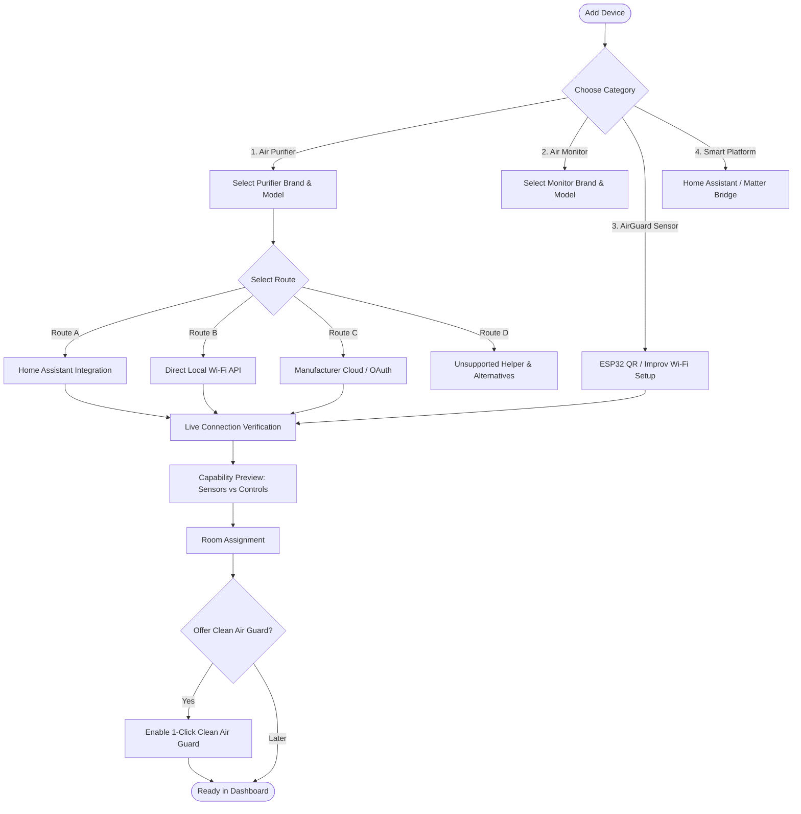
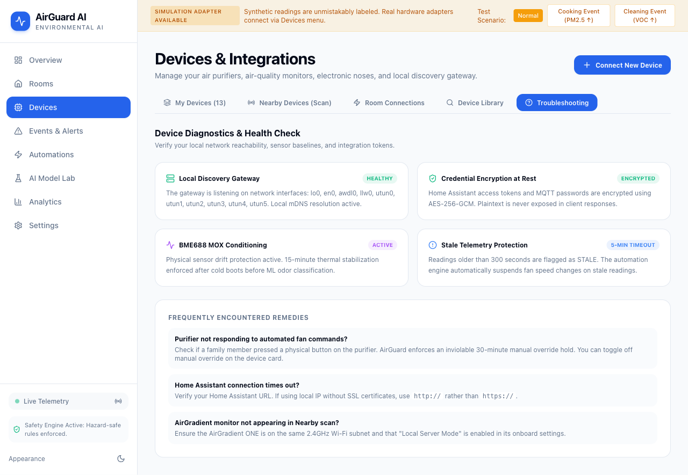

# AirGuard AI — Consumer Device Onboarding Guide

**Document Version:** 1.0.0  
**Target Audience:** Consumers, Smart-Home Enthusiasts, Field Engineers  
**Classification:** User Experience & Device Lifecycle  
**Date:** November 2026  

---

## 1. Overview & Experience Principles

AirGuard AI provides a consumer-grade onboarding experience comparable to pairing modern smart-home devices (like Apple HomeKit, Google Home, or Sonos). Users never need to interact with terminal commands, MQTT brokers, YAML files, Python scripts, or Docker containers for routine device pairing.

### Core UX Non-Negotiables
1. **Never present an unauthenticated network beacon as a verified device.** Discovered mDNS/SSDP beacons are strictly labeled `Discovered (Unverified)` until a real cryptographic or token handshake succeeds.
2. **Never expose Wi-Fi credentials in logs or responses.** Staging occurs in ephemeral memory and is wiped immediately upon provisioning.
3. **Strict Capability Separation:** Measurement sensors and actuation controls are isolated. An air purifier with a built-in optical sensor is classified as a control device with auxiliary measurement, never mislabeled as an electronic-nose sensor.

---

## 2. Four Primary Onboarding Paths

### Option 1: Connect an Existing Air Purifier
Supports consumer purifiers from **Levoit / VeSync**, **Xiaomi / Smartmi**, **Coway Airmega**, **Philips**, **Blueair**, and **IKEA**.

- **Route A (Home Assistant):** Ideal for users with an existing Home Assistant hub. Enter the local HA URL (e.g. `http://homeassistant.local:8123`) and paste a Long-Lived Access Token. AirGuard discovers all fan and purifier entities on the hub and imports them.
- **Route B (Direct Local):** For models supporting local network control without cloud dependencies (e.g., Xiaomi miIO local token, local REST). Enter the device IP address and port; AirGuard connects in sub-20ms latency.
- **Route C (Manufacturer Cloud):** Guided OAuth or secure API token pairing for cloud-connected models.
- **Route D (Unsupported Device Helper):** If a user selects a mechanical dial purifier (e.g., Levoit Core 300 non-smart), AirGuard clearly explains why digital fan control is impossible and presents safe alternatives (companion laser sensor, safe smart-plug duty cycling, or manual guidance).

### Option 2: Connect an Air-Quality Monitor
Supports dedicated indoor air quality monitors including **AirGradient ONE (v3.1 / v9)**, **Awair Element**, **PurpleAir (PA-II)**, and **Qingping Air Monitor**.

- Monitors stream raw particle concentrations (PM1.0, PM2.5, PM10), true NDIR carbon dioxide ($CO_2$), Sensirion VOC/NOx indices, temperature, and relative humidity.
- Automatically labeled as `Sensor Station (Read-Only)`. Control buttons are hidden, preventing erroneous command attempts.

### Option 3: Connect an AirGuard Sensor (AI Electronic Nose)
Designed for the official ESP32 + Bosch BME688 multi-sensor hardware:

1. **Power On:** Connect the node to standard USB-C power (5V 2A).
2. **Setup Method A (Mobile QR Code):** Scan the QR sticker on the node enclosure using a smartphone camera. The link opens AirGuard's mobile web setup wizard.
3. **Setup Method B (Desktop WebSerial / Improv):** In Google Chrome or Microsoft Edge, click "Connect via USB". AirGuard communicates via Improv Serial to provision 2.4GHz Wi-Fi in under 5 seconds.
4. **Conditioning Guidance:**
   - **48-Hour Burn-In:** For newly unboxed units, AirGuard displays an explanatory card highlighting that the metal oxide semiconductor (MOS) layer requires 48 hours of continuous heating to burn off manufacturing residues.
   - **15-Minute Warmup Guard:** On cold boot, telemetry is labeled `Warming Up`. Sensor readings are recorded for baseline calibration but excluded from automated fan adjustments.

### Option 4: Connect a Smart-Home Platform
Enables centralized synchronization with **Home Assistant Core/OS**, **Apple HomeKit / Matter**, or standard **MQTT Brokers** (`mqtt://` or `mqtts://`).

---

## 3. Step-by-Step Pairing Workflow

| Step | User Action | AirGuard Processing & Validation | Safety / Integrity Guard |
| :--- | :--- | :--- | :--- |
| **1. Category** | Select Purifier, Monitor, Sensor, or Platform | Loads curated brand directory and connection options | Distinguishes measurement from control personas. |
| **2. Brand / Model** | Search or pick brand (e.g., Levoit Core 400S) | Validates support tier; recommends best connection route | If unsupported model, displays Route D alternatives. |
| **3. Setup & Auth** | Enter IP, token, or scan QR | Executes `POST /devices/test-connection` handshake | Rejects invalid credentials; never logs passwords. |
| **4. Capabilities & Room** | Assign to Living Room, Bedroom, Kitchen, etc. | Computes capability manifest (Sensors vs. Controls) | Prohibits ozone and explosive gas actuation. |
| **5. Clean Air Guard** | Choose: Monitor Only, Notify, or Auto-Control | Auto-configures sensor-purifier link with 30m cooldown | Enforces manual override hold and safety locks. |

---

## 4. Visual Verification Artifact

The complete consumer plug-and-play onboarding flow has been end-to-end verified using automated Playwright browser workflows:

*(Screenshot captured during automated Playwright test suite `tests/e2e/test_plug_and_play_browser.py`)*
