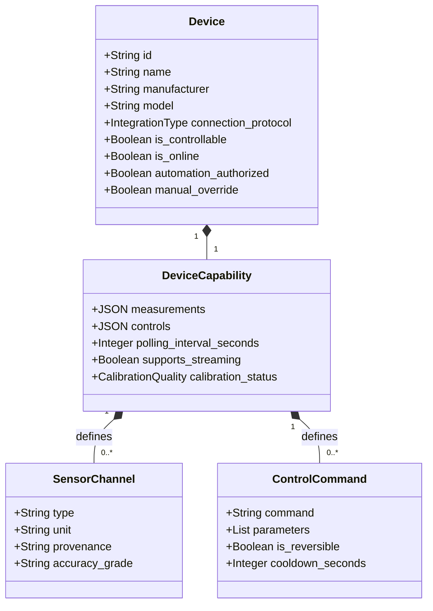

# AirGuard AI — Device Capability Matrix & Taxonomy

**Document Version:** 1.0.0  
**Classification:** Data Modeling, Schema Governance & Hardware Integrity  
**Date:** November 2026  

---

## 1. Capability System Principles

AirGuard AI enforces an absolute architectural separation between **measurement sensors** and **actuation controls**. Every device record in the `devices` table is paired with a canonical `device_capabilities` manifest that explicitly documents what the hardware can measure and what physical actions it can execute.

### Core Data Integrity Rules
1. **Never Invent Capabilities:** If a device does not possess a hardware sensor or control command, AirGuard displays `Not supported`.
2. **Never Conflate Controls with Odor ML:** An air purifier that possesses an auxiliary optical particle counter is classified as a **Control Device**, never as an electronic-nose sensor. Electronic-nose models accept raw multi-temperature MOX resistance vectors, which consumer purifiers do not provide.
3. **NDIR $CO_2$ vs. Estimated $eCO_2$:** True non-dispersive infrared (NDIR) $CO_2$ measurements (from Senseair S8) are flagged as `MEASURED` with physical unit `ppm`. Estimates derived from VOC sensor resistance (like BME680/688 $eCO_2$) are strictly labeled as `DERIVED`.

---

## 2. Canonical Sensor Taxonomy

| Measurement Type | Physical Phenomenon | Canonical Unit | Typical Sensor Hardware | Provenance Classification |
| :--- | :--- | :--- | :--- | :--- |
| `PM1_0` | Particulate matter $<1.0\ \mu\text{m}$ | $\mu\text{g/m}^3$ | Plantower PMS5003 / Sensirion SPS30 | `MEASURED` (Laser scattering) |
| `PM2_5` | Fine inhalable particles $<2.5\ \mu\text{m}$ | $\mu\text{g/m}^3$ | Plantower PMS5003 / Honeywell HPMA | `MEASURED` (Laser scattering) |
| `PM10` | Inhalable coarse dust $<10\ \mu\text{m}$ | $\mu\text{g/m}^3$ | Plantower PMS5003 / Sensirion SPS30 | `MEASURED` (Laser scattering) |
| `CO2` | True Carbon Dioxide concentration | $\text{ppm}$ | Senseair S8 / SCD30 | `MEASURED` (Optical NDIR) |
| `ECO2` | Estimated Carbon Dioxide equivalent | $\text{ppm}$ | Bosch BME688 / Sensirion SGP30 | `DERIVED` (VOC-correlated proxy) |
| `VOC_INDEX` | Volatile Organic Compounds index | $\text{index (1–500)}$ | Sensirion SGP40 | `DERIVED` (Relative algorithm) |
| `NOX_INDEX` | Nitrogen Oxides index | $\text{index (1–500)}$ | Sensirion SGP41 | `DERIVED` (Relative algorithm) |
| `TEMPERATURE` | Ambient temperature | $^\circ\text{C}$ | Sensirion SHT40 / BME688 | `MEASURED` (Thermistor / bandgap) |
| `HUMIDITY` | Relative humidity | $\%$ | Sensirion SHT40 / BME688 | `MEASURED` (Capacitive polymer) |
| `PRESSURE` | Atmospheric barometric pressure | $\text{hPa}$ | Bosch BME688 / BMP390 | `MEASURED` (Piezoresistive) |
| `GAS_RESISTANCE` | Metal oxide semiconductor surface resistance | $\Omega$ | Bosch BME688 (10-step heater) | `MEASURED` (MOX conductivity) |

---

## 3. Canonical Control Taxonomy

| Control Command | Parameter Spec | Valid Parameter Values | Hardware Target | Safety Constraints |
| :--- | :--- | :--- | :--- | :--- |
| `set_speed` | `{"speed": int}` | `1` (Low), `2` (Med), `3` (High), `4` (Turbo) | BLDC Fan Motor | Throttled to max 1 cmd per 30 seconds; 30-min manual override hold. |
| `turn_on` | `{}` | None | AC / DC Relay | Hard-locked OFF during suspected combustible gas or fire alarms. |
| `turn_off` | `{}` | None | AC / DC Relay | Safe always; immediate execution. |
| `set_mode` | `{"mode": str}` | `"auto"`, `"sleep"`, `"turbo"`, `"eco"` | Controller State Machine | Auto mode yields to manual physical button presses. |
| `set_display` | `{"state": bool}` | `true` (On), `false` (Off / Dim) | LED / OLED Driver | Night comfort control. |
| `set_child_lock`| `{"locked": bool}` | `true`, `false` | Physical Keypad Lock | Prevents accidental changes by occupants. |
| `trigger_ota` | `{"url": str}` | HTTPS firmware binary URL | ESP32 Flash Controller | Requires explicit admin confirmation. |

---

## 4. Hardware Profiles Comparison

| Device Profile | Device Classification | Supported Sensors | Supported Controls | Unsupported Features |
| :--- | :--- | :--- | :--- | :--- |
| **Levoit Core 400S** | Control Device (Smart Purifier) | Laser PM2.5 | `set_speed` (1–4), `turn_on`, `turn_off`, `set_mode`, `set_display` | Ozone generation (Forbidden); CO2; VOC Index; Electronic Nose. |
| **AirGradient ONE** | Sensor Station (Environmental Monitor) | PM1.0, PM2.5, PM10, NDIR CO2, VOC Index, NOx Index, Temp, Humidity | None (Read-only monitor) | All physical controls (No fan motor). |
| **AirGuard Sensor Node** | AI Electronic Nose (Pattern Recognition) | 10-step Gas Resistance ($100^\circ\text{C}–400^\circ\text{C}$), Temp, Humidity, Pressure, Laser PM2.5, NDIR CO2 | `trigger_ota`, `calibrate_baseline` | Air filtration (Pure sensing node; pairs with purifier for filtration). |
| **Home Assistant Hub** | Bridge Platform | All bridged entity sensors | All bridged entity fans and switches | Direct non-network hardware actuation. |
| **Mechanical Purifier** | Legacy / Unsupported Device | None | None (Mechanical switch only) | Digital Wi-Fi control (Supported via smart plug duty-cycle only). |
