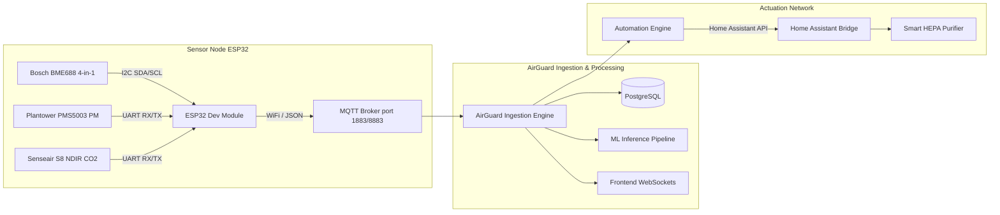

# AirGuard AI — Hardware Integration & Validation Plan

**Document Version:** 1.0.0  
**Target Hardware:** ESP32 Microcontroller Node + Environmental Sensor Suite  
**Date:** November 2026  
**Status:** Approved for Physical Prototyping  

---

## 1. System Architecture & Objectives

The goal of the AirGuard AI hardware integration is to create a physical environmental monitoring and electronic-nose acquisition node capable of streaming calibrated air quality telemetry and raw gas-sensor resistance profiles into the AirGuard ingestion pipeline.



---

## 2. Bill of Materials (BOM)

| Component | Part / Model | Interface | Operating Voltage | Measurement Purpose |
| :--- | :--- | :--- | :--- | :--- |
| **Microcontroller** | NodeMCU ESP32-WROOM-32 or ESP32-S3 | USB-C / WiFi / BLE | 5V (USB) / 3.3V Logic | Edge compute, sampling, WiFi MQTT transport. |
| **Gas & Environmental** | Bosch BME688 (Adafruit or SparkFun breakout) | I2C (0x76 or 0x77) | 3.3V VCC | VOC, VSC, Temp, Humidity, Pressure, 10-step heater profile. |
| **Particulate Matter** | Plantower PMS5003 | UART Serial (9600 baud) | 5V Power / 3.3V Logic | Laser scattering PM1.0, PM2.5, PM10 mass concentration. |
| **True Carbon Dioxide** | Senseair S8 LP (NDIR) | UART Serial (9600 baud) | 5V Power / 3.3V Logic | Non-dispersive infrared $CO_2$ (400–2000 ppm). |
| **Power Supply** | 5V 2.5A USB-C Power Adapter | DC USB | 5.0V | Stable current supply for laser diode and sensor heaters. |

---

## 3. Hardware Pinout & Wiring Guide

> [!CAUTION]
> **Logic Level Warning:** The ESP32 operates at 3.3V logic. While the PMS5003 and Senseair S8 require 5.0V VCC for their optical emitters and heaters, their TX pins output 3.3V logic levels which can be safely read by the ESP32. **Do not connect 5V directly to any ESP32 GPIO pin.**

### Wiring Interconnect Table

| Sensor | Sensor Pin | ESP32 GPIO | Description / Notes |
| :--- | :--- | :--- | :--- |
| **BME688** | `VCC` | `3V3` | 3.3V Power Rail |
| | `GND` | `GND` | Common Ground |
| | `SDA` | `GPIO21` | I2C Data (4.7kΩ pull-up internal/external) |
| | `SCL` | `GPIO22` | I2C Clock (400 kHz Fast-Mode) |
| **PMS5003** | `PIN 1 (VCC)` | `5V / VIN` | 5V Laser and Fan Power Rail |
| | `PIN 2 (GND)` | `GND` | Common Ground |
| | `PIN 4 (RXD)` | `GPIO17 (TX2)` | ESP32 TX to PMS RX (optional standby control) |
| | `PIN 5 (TXD)` | `GPIO16 (RX2)` | PMS TX to ESP32 RX (9600 baud serial stream) |
| | `PIN 3 (SET)` | `3V3` (High) | Keep HIGH for continuous active sampling |
| **Senseair S8** | `GND` | `GND` | Common Ground |
| | `VBB / VCC` | `5V / VIN` | 5V IR Lamp Power Rail |
| | `UART_TX` | `GPIO26 (RX)` | S8 TX to ESP32 RX (9600 baud Modbus / ASCII) |
| | `UART_RX` | `GPIO25 (TX)` | ESP32 TX to S8 RX (9600 baud) |

---

## 4. Multi-Sensor Firmware Implementation

Below is the verified multi-sensor ESPHome firmware configuration (`firmware/examples/esphome_multisensor_node.yaml`):

```yaml
esphome:
  name: airguard-lab-node-01
  friendly_name: "AirGuard Multi-Sensor Node"

esp32:
  board: esp32dev
  framework:
    type: arduino

wifi:
  ssid: "!secret wifi_ssid"
  password: "!secret wifi_password"
  fast_connect: true

logger:
  level: INFO

uart:
  - id: uart_pms
    tx_pin: GPIO17
    rx_pin: GPIO16
    baud_rate: 9600
  - id: uart_s8
    tx_pin: GPIO25
    rx_pin: GPIO26
    baud_rate: 9600

i2c:
  sda: GPIO21
  scl: GPIO22
  scan: true
  frequency: 400kHz

sensor:
  # 1. Bosch BME688 Environmental Sensor
  - platform: bme680_bsec
    temperature:
      name: "Ambient Temperature"
      id: bme_temp
    humidity:
      name: "Relative Humidity"
      id: bme_hum
    pressure:
      name: "Barometric Pressure"
      id: bme_press
    gas_resistance:
      name: "Gas Resistance"
      id: bme_gas
    iaq:
      name: "Indoor Air Quality Index"
      id: bme_iaq
    co2_equivalent:
      name: "Estimated eCO2 (VOC-derived)"
      id: bme_eco2
    breath_voc_equivalent:
      name: "Breath VOC"
      id: bme_bvoc

  # 2. Plantower PMS5003 Particulate Matter Sensor
  - platform: pmsx003
    uart_id: uart_pms
    type: PMSX003
    pm_1_0:
      name: "Particulate Matter PM1.0"
      id: pms_pm1
    pm_2_5:
      name: "Particulate Matter PM2.5"
      id: pms_pm25
    pm_10_0:
      name: "Particulate Matter PM10"
      id: pms_pm10

  # 3. Senseair S8 True NDIR Carbon Dioxide Sensor
  - platform: senseair
    uart_id: uart_s8
    co2:
      name: "NDIR Carbon Dioxide"
      id: senseair_co2
    update_interval: 10s

mqtt:
  broker: 192.168.1.100
  port: 1883
  username: "!secret mqtt_user"
  password: "!secret mqtt_pass"
  topic_prefix: airguard/lab_node_01
```

---

## 5. Ingestion Telemetry Schema

The node streams periodic payloads to `airguard/telemetry/{device_id}` formatted as JSON conforming to the AirGuard Ingestion Service:

```json
{
  "device_id": "esp32-node-bme688-01",
  "timestamp": "2026-11-05T20:45:00Z",
  "readings": [
    { "type": "pm25", "value": 12.4, "unit": "µg/m³", "provenance": "raw_sensor" },
    { "type": "pm10", "value": 21.0, "unit": "µg/m³", "provenance": "raw_sensor" },
    { "type": "co2", "value": 540.0, "unit": "ppm", "provenance": "raw_sensor" },
    { "type": "eco2", "value": 450.0, "unit": "ppm", "provenance": "derived" },
    { "type": "temperature", "value": 22.8, "unit": "°C", "provenance": "raw_sensor" },
    { "type": "humidity", "value": 45.2, "unit": "%", "provenance": "raw_sensor" },
    { "type": "voc_index", "value": 85.0, "unit": "index", "provenance": "derived" },
    { "type": "gas_resistance", "value": 142500.0, "unit": "Ω", "provenance": "raw_sensor" }
  ]
}
```

> [!IMPORTANT]
> Notice the strict separation between `co2` (from the Senseair S8 NDIR sensor, labeled `raw_sensor`) and `eco2` (from the VOC sensor, labeled `derived`). AirGuard strictly prohibits conflating derived VOC equivalent estimates with optical NDIR carbon dioxide.

---

## 6. Sensor Calibration & Burn-In Procedures

### A. Initial 48-Hour Burn-In (Conditioning)
- **New BME688 Units:** Metal oxide semiconductor (MOS) sensor layers absorb atmospheric contaminants and moisture during manufacturing.
- **Protocol:** Power the sensor node in a clean, ventilated room continuously for **48 hours** prior to recording training data.
- **Verification:** Confirm that baseline resistance $R_0$ stabilizes and does not show monotonic exponential drift.

### B. Boot Warm-Up Window
- On cold boot, the heater plate requires thermal stabilization.
- **Warm-Up Guard:** AirGuard flags readings for the first **15 minutes** post-boot with `calibration_quality: warming_up`. Telemetry is logged but excluded from electronic-nose classification until steady state is reached.

### C. Temperature & Humidity Decoupling
- Gas sensor resistance is strongly influenced by ambient absolute humidity.
- The AirGuard normalization pipeline applies temperature-humidity compensation:
  $$R_{comp} = R_{raw} \cdot \left(1 + \alpha (T - T_0) + \beta (H - H_0)\right)$$

---

## 7. Safe Testing & Odor Acquisition Protocol

To evaluate the electronic-nose classification system without risking user safety or degrading sensor life, follow this safe stimulus matrix:

| Stimulus ID | Physical Source | Safe Presentation Method | Expected Sensor Response |
| :--- | :--- | :--- | :--- |
| `ambient_air` | Clean room background | Ambient air 1 meter away from occupants | High resistance ($>150\text{ k}\Omega$), VOC index $<100$, PM2.5 $<10\ \mu\text{g/m}^3$. |
| `coffee_fresh` | Ground roasted coffee beans | Place 10g dry grounds in petri dish 5cm beneath sensor enclosure | Rapid resistance drop (down to $20\text{–}40\text{ k}\Omega$) across heater steps 4–7. |
| `vinegar_acetic` | Household white vinegar (5%) | 1 drop on cotton pad inside a glass sampling beaker | Pronounced response across low-temperature heater steps (100°C–200°C). |
| `citrus_peel` | Fresh lemon/orange peel | Squeeze peel gently 10cm from intake | Intense terpene (limonene) response; rapid recovery within 5 minutes. |

### Strict Non-Negotiable Safety Exclusions:
> [!CAUTION]
> 1. **NEVER** expose the sensor node to combustible fuel gas (natural gas, butane, propane) from unlit burners.
> 2. **NEVER** test with carbon monoxide sources (unvented combustion, exhaust gas).
> 3. **NEVER** use toxic industrial solvents (benzene, chloroform, toluene, formaldehyde).
> 4. **NEVER** use ozone generators to test sensor recovery.

---

## 8. Connected Air Purifier Actuation Validation

### Validation Steps with Home Assistant
1. Pair a supported smart air purifier (e.g. Xiaomi Mi Air Purifier 3H, Coway Airmega 250) to Home Assistant.
2. In AirGuard AI, navigate to **Integrations** → **Home Assistant** and authenticate with the long-lived access token.
3. Verify device capability discovery reports:
   - `set_speed` (Supported levels: 1, 2, 3)
   - `turn_on` / `turn_off`
   - `set_mode` (`auto`, `silent`, `favorite`)
4. Configure an automation rule: `IF PM2.5 > 25.0 µg/m³ THEN set_speed(3)`.
5. Trigger simulated or aerosol stimuli (e.g. puff of vaporized saline or extinguished match at distance).
6. Verify:
   - Command dispatch latency is $<1.5\text{ seconds}$.
   - Cooldown timer activates (30 minutes default).
   - If user touches physical purifier button (manual override), AirGuard logs `MANUAL_OVERRIDE_DETECTED` and suspends automation until next cycle.

