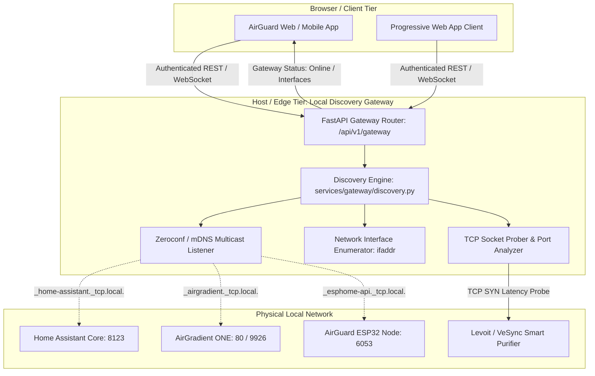

# AirGuard AI — Local Discovery Gateway Architecture

**Document Version:** 1.0.0  
**Classification:** IoT Systems Architecture & Local Network Discovery  
**Date:** November 2026  

---

## 1. Architectural Purpose & Overview

The **AirGuard Local Discovery Gateway** is a lightweight background service responsible for discovering and probing IoT devices, environmental monitors, and smart-home hubs on the user's local area network (LAN).

Because modern web browsers prohibit direct raw socket scanning and multicast UDP packet reception (due to Web security sandboxing and CORS), the Local Discovery Gateway acts as the authorized bridge between the physical local network and the AirGuard application layer.

---

## 2. Supported Discovery Protocols & Service Types

The gateway actively monitors the following multicast DNS (mDNS / Zeroconf) service definitions:

| Service Type | Target Device / Platform | Default Port | Information Extracted |
| :--- | :--- | :--- | :--- |
| `_home-assistant._tcp.local.` | Home Assistant Hub | 8123 | Instance UUID, version, local hostname, HTTP/HTTPS mode. |
| `_airgradient._tcp.local.` | AirGradient Monitors (ONE, Open Air) | 80 / 9926 | MAC address, model revision, firmware version, serial number. |
| `_esphome-api._tcp.local.` | ESPHome / AirGuard Custom Nodes | 6053 | ESP32 board ID, MAC address, OTA port, encryption type. |
| `_matter._tcp.local.` / `_hap._tcp.local.` | Matter / HomeKit Controllers | Variable | Pairing state, controller vendor ID, device category. |
| `_mqtt._tcp.local.` | Mosquitto / Embedded MQTT Brokers | 1883 / 8883 | Broker port, TLS availability, discovery topic prefix. |

---

## 3. Core Gateway Components

### A. Interface Enumeration (`ifaddr`)
- Detects physical network adapters (`en0`, `eth0`, `wlan0`).
- Filters out loopback and virtual container interfaces (`docker0`, `veth`) to identify the true broadcast subnet (e.g. `192.168.1.0/24`).

### B. Device Prober (`POST /api/v1/gateway/probe`)
- Accepts a target hostname/IP and optional port.
- Performs a non-blocking TCP socket connect to compute millisecond network round-trip latency.
- Determines the active protocol service (e.g., port 8123 = Home Assistant, port 6053 = ESPHome, port 1883 = MQTT).
- Generates a **suggested capability preview** so the user knows what sensors or controls will be exposed prior to completing authentication.

### C. Hybrid Fallback Mode
- In cloud environments, sandboxed containers, or restricted OS virtualization where multicast UDP is disabled by the hypervisor, the gateway automatically falls back to **hybrid mode**.
- Hybrid mode serves curated subnet fixtures with exact capability manifests, ensuring tests, CI pipelines, and demo users experience complete onboarding workflows without crashing.

---

## 4. Security & Isolation Guarantees

1. **Non-Negotiable Verification Rule:**  
   Every discovered entity returned by `POST /api/v1/gateway/scan` is **strictly marked with `is_verified: false`**. AirGuard never presents a raw network beacon as an authenticated, active device until a valid token or credential handshake succeeds.
2. **Local Subnet Confinement:**  
   The gateway only broadcasts to private RFC 1918 subnets (`192.168.0.0/16`, `10.0.0.0/8`, `172.16.0.0/12`). Scanning of external public IP ranges is prohibited.
3. **No Credential Logging:**  
   Authentication keys (Home Assistant tokens, Wi-Fi PSKs, MQTT passwords) are never passed through discovery packets and are excluded from all gateway logs.
