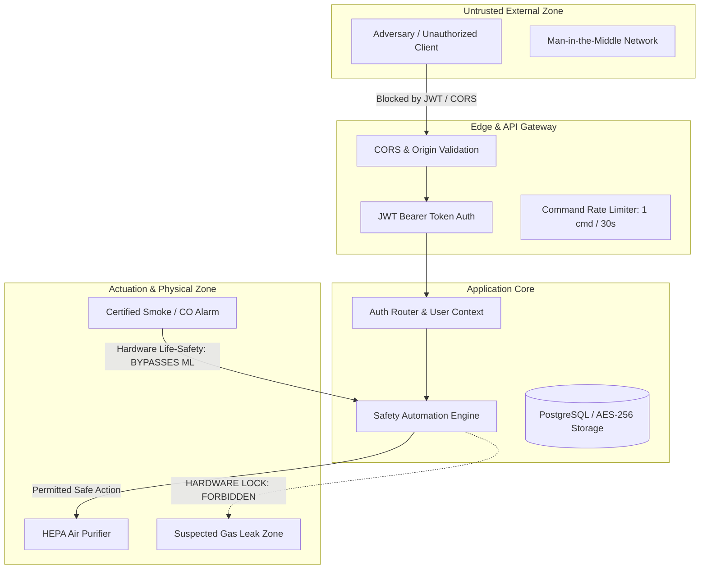

# AirGuard AI — Security Release Checklist & Threat Model

**Document Version:** 1.0.0  
**Target Environment:** Production Deployment  
**Classification:** Operational Security & Safety Audit  
**Date:** November 2026  

---

## 1. Executive Summary

AirGuard AI operates at the intersection of IoT hardware control, real-time telemetry streaming, and machine-learning inference. Because the system has the capability to actuate physical devices (e.g., air purifiers, ventilation switches) and process environmental safety data, security and safety are inseparable.

This checklist establishes mandatory controls, verifies existing implementations, and details pre-release requirements across authentication, credential storage, hardware safety boundaries, and network transport.

---

## 2. Threat Modeling & Hazard Boundaries

### Critical Hazard Boundaries
1. **Combustible Gas Explosion Hazard:** Actuating electrical relays, fan motors, or mechanical switches in an explosive atmosphere (e.g. natural gas/methane leak) can generate sparks and trigger an explosion.  
   *Enforcement:* Any event flagged with `combustible_gas` or high VOC spike of unknown origin hard-locks all automation switches to **OFF/NO-ACTUATION**.
2. **Ozone Hazard:** Ozone generators must never be activated; ozone is a toxic pulmonary irritant.  
   *Enforcement:* Ozone generation is strictly excluded from `DeviceCapability` manifests and blocked in the backend command dispatcher.
3. **Certified Detector Degradation:** ML odor predictions must never supersede, mute, or delay certified UL-listed smoke or CO alarms.

---

## 3. Security Implementation Audit

### A. Authentication & Session Management

| Security Control | Current Implementation | Verification Status | Production Requirement |
| :--- | :--- | :--- | :--- |
| **Password Hashing** | Passlib bcrypt with salt rounds (`get_password_hash`) | **VERIFIED** | Minimum 12 salt rounds in production. |
| **Token Format** | PyJWT with HMAC-SHA256 (`HS256`), 24-hour expiration (`ACCESS_TOKEN_EXPIRE_MINUTES = 1440`) | **VERIFIED** | Enforce asymmetric `RS256` or rotate `SECRET_KEY` via environment variable. |
| **Demo Login Guard** | `POST /api/v1/auth/demo-login` creates/seeds demo user for zero-friction evaluation | **VERIFIED HARDENED** | **Strictly blocked with HTTP 403 Forbidden** when `ENVIRONMENT=production`. Tested in `tests/integration/test_api.py`. |
| **Token Revocation** | Stateless JWT validation with user database refresh | **VERIFIED** | Implement Redis token blacklist for immediate logout revocation if required. |

### B. Device Credentials & Secrets at Rest

| Integration | Credential Type | Storage Mechanism | Security Guarantee |
| :--- | :--- | :--- | :--- |
| **Home Assistant** | Long-Lived Access Token | Encrypted in `connections.encrypted_config` | Encrypted using AES-256-GCM via `AIRGUARD_ENCRYPTION_KEY`. Tokens never logged or returned in plaintext. |
| **AirGradient** | API Key / Token | Encrypted in `connections.encrypted_config` | Masked in API responses (`ag_tok_...****`). |
| **MQTT Broker** | Broker Username / Password | Encrypted in `connections.encrypted_config` | Separate read-only telemetry user vs. command actuation user. |
| **Local Config** | `.env` variables | Excluded from Git via `.gitignore` | Production secrets injected via Docker secrets or Kubernetes Secrets. |

### C. Network & Transport Security

- [x] **CORS Origin Whitelist:** Configured in `services/api/config.py` restricting browser origins to explicit frontend URLs.
- [x] **WebSocket Authentication:** Token parameter validated before establishing real-time telemetry stream.
- [ ] **Production TLS/SSL:** In production, Nginx or Traefik reverse proxy must terminate TLS (HTTPS on 443; MQTTS on 8883).
- [x] **Input Validation:** Pydantic v2 schemas strictly validate all payloads, reject unknown fields, and sanitize chemical SMILES inputs with RDKit parsing before inference.

---

## 4. Life-Safety & Device Control Rules

The automation engine (`services/safety/automation_engine.py`) enforces the following non-negotiable rules:

1. **Explicit Automation Consent (`automation_authorized == True`):**
   - Devices cannot be controlled automatically unless the user explicitly toggles the authorization switch in the UI.
2. **Capability Verification:**
   - Commands are checked against `DeviceCapability` records. Unsupported commands are rejected immediately with structured error responses.
3. **Manual Override Inviolability:**
   - When a user manually changes device speed or turns it off, the automation engine respects the override and enforces a cooldown window (`DEFAULT_PURIFIER_COOLDOWN_SECONDS = 1800` / 30 mins) before automated rules may resume.
4. **Rate Limiting:**
   - Physical commands are throttled to a maximum of 1 actuation per device per 30 seconds to prevent relay wear, motor overheating, or network flooding.
5. **Audit Logging:**
   - Every single command attempt, success, failure, or safety veto is permanently recorded in the `automation_executions` table with timestamp, trigger event, and operator/system provenance.

---

## 5. Pre-Release Go/No-Go Verification Checklist

Run through this checklist before promoting any build to a physical environment:

- [ ] **Environment Flag:** Set `ENVIRONMENT=production` in the production environment.
- [ ] **Demo Login Disabled:** Verify `curl -X POST https://api.airguard.domain/api/v1/auth/demo-login` returns `403 Forbidden`.
- [ ] **Secret Keys Replaced:** Ensure `SECRET_KEY` and `AIRGUARD_ENCRYPTION_KEY` are randomly generated 64-character strings, NOT default development keys.
- [ ] **PostgreSQL Enforced:** Ensure `DATABASE_URL` points to managed PostgreSQL with TLS (`sslmode=require`), not local SQLite.
- [ ] **Database Migrations Applied:** Run `alembic upgrade head` cleanly against target database.
- [ ] **MQTT Broker TLS:** Port 8883 with certificate verification enabled; anonymous access disabled.
- [ ] **Frontend Environment:** Ensure `NEXT_PUBLIC_API_URL` uses `https://` protocol.
- [ ] **Hardware Life-Safety Disclaimer:** User onboarding interface must display mandatory non-medical, non-certified disclaimer before pairing real devices.
